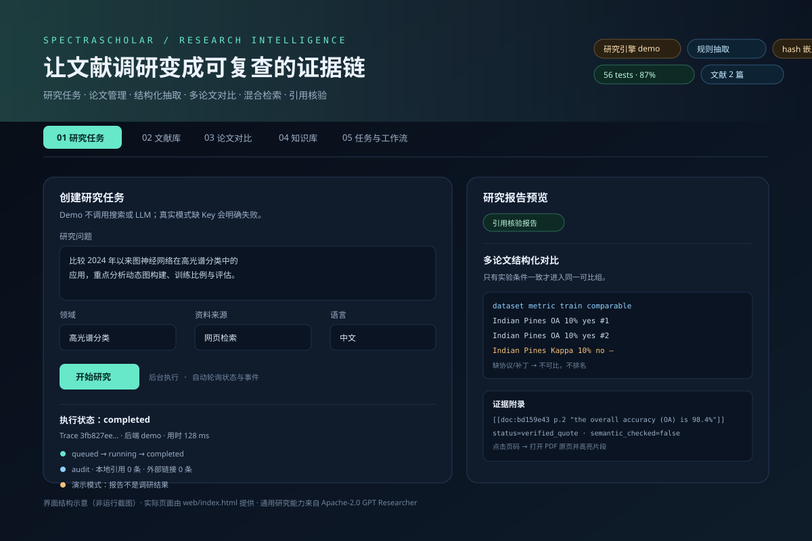
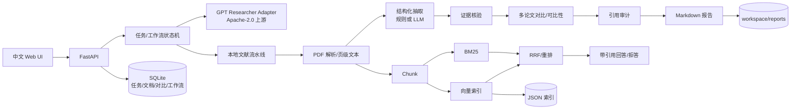

# SpectraScholar

> 面向科研文献调研的可核查 AI Agent：任务规划、论文管理、结构化抽取、多论文对比、混合 RAG 与引用核验。
>
> 通用网页研究/检索/报告生成由 **GPT Researcher**（Apache-2.0）提供；本仓库的科研业务层、证据约束、可比性分析、混合检索与工作流是个人二次开发。


---

## 1. 这个项目解决什么问题？

通用 Deep Research 工具能“搜到并写出报告”，但科研阅读还多出三个问题：

1. **来源可追溯**：报告里的每个数字，能否回到具体 PDF 的页码和原文片段？
2. **实验可比性**：两篇论文都写了 OA=98%，但它们的数据集、训练比例、补丁尺寸和划分协议一样吗？
3. **拒绝编造**：找不到证据时，系统是否会返回 `null` / 拒答，而不是“合理推测”一个数值？

SpectraScholar 把这三件事做成了显式契约：

- 结构化字段必须绑定 `document_id + page + quote + verification status`；
- 只有实验条件完全一致的指标才进入同一可比组并排名；
- 引用核验区分 **原文片段通过**、**仅页码通过**、**失败引用** 和 **缺少引用的数值结论**；
- RAG 在空检索或低重合时**拒答**，不调用模型补全；
- Demo 模式在任务、报告、页面三处明确标注，不冒充真实调研。

---

## 2. 先看结论：哪些真实可用、哪些尚未验证

| 能力 | 状态 | 证据 |
|---|---|---|
| FastAPI 服务、网页、PDF 上传、任务历史、Docker 配置 | ✅ 已实现并本地运行 | HTTP 冒烟 + 61 个 pytest |
| Demo 调研任务（不调用搜索/LLM） | ✅ 已实现 | 报告中明确“不是调研结果” |
| GPT Researcher Adapter | ✅ 代码完成，API 签名按 **0.16.1** 源码核对 | Mock 集成测试覆盖成功/空响应/超时/重试/缺密钥 |
| GPT Researcher 真实联网 + 真实模型端到端 | ⚠️ **未验证** | 当前环境无 API Key，且外网直连被阻断 |
| 规则结构化抽取（方法/数据集/指标/图构建/实验条件） | ✅ 已实现 | 三份合成夹具 20/20 字段命中、23/23 原文证据通过 |
| PDF 表格结构解析（OA/AA/Kappa 行列） | ✅ 已实现 | pdfplumber + 带线表格夹具；无表格时自动降级 |
| LLM 结构化抽取 + 逐字证据拒绝 | ✅ 代码与假模型测试完成 | 幻觉数值/引文会被丢弃并记录 |
| 真实 LLM 抽取效果 | ⚠️ **未验证** | 没有可用模型 API |
| 多论文对比、可比性分组、Markdown 导出 | ✅ 已实现 | OA 条件一致时正确排名；Kappa 单篇不排名 |
| 引用核验（页码/原文/外部链接/缺引用结论） | ✅ 已实现 | 单测 + 报告自动附加核验节 |
| 混合 RAG（BM25 + 向量 + RRF + 词法重排） | ✅ 已实现 | 合成夹具 Recall@1/3 = 1.0（仅流水线验证） |
| hash 嵌入的语义质量 | ❌ **不能宣称** | hash 是词法哈希，不是语义模型；需切换 OpenAI embedding 后重测 |
| 真实论文测试集（HybridSN/SSRN/GNN） | ⚠️ 清单已建，PDF 未下载 | 见 `eval/papers.manifest.json`；不伪造真实指标 |
| Docker 镜像构建 | ⚠️ **未验证** | 当前机器没有 Docker CLI |
| 网页视觉截图 | ⚠️ 未生成 | Chrome 被 Windows 沙箱阻断（命名管道权限） |

> 本项目坚持一条原则：**没有真实运行过的能力，不写成“已完成真实联调”。**

### 界面结构示意



> 上图是**结构示意**，不是运行截图。当前 Windows 沙箱禁止 Chrome 的 Mojo 命名管道，headless 截图失败；页面本身已通过真实 Uvicorn 服务返回 200、内联 JS 通过 `node --check`、所有 API 通过 HTTP 冒烟。在普通桌面环境可直接打开 `http://127.0.0.1:8000/` 查看真实界面，截图命令见 [`docs/DEMO.md`](docs/DEMO.md)。

---

## 3. 我做了什么，GPT Researcher 做了什么

| 范围 | 归属 |
|---|---|
| Web 搜索、网页抓取、上下文管理、报告生成、上游多 Agent 流程 | **GPT Researcher（Apache-2.0）** |
| FastAPI 服务、任务状态机、执行日志、超时/重试/错误分类 | 个人开发 |
| 每任务 GPT Researcher 配置隔离（web/local、模型、检索器） | 个人开发 |
| PDF 上传安全、SHA-256 去重、页级文本读取 | 个人开发 |
| 规则/LLM 结构化抽取与 Pydantic 契约 | 个人开发 |
| 页码 + 原文片段证据核验，失败候选拒绝 | 个人开发 |
| 多论文方法/数据集/指标对比，实验条件与不可比标记 | 个人开发 |
| 报告引用审计、缺引用数值结论检测 | 个人开发 |
| PDF chunk → BM25 + 向量 + RRF → 带页引用回答 | 个人开发（不复制上游 RAG） |
| 本地文献工作流 DAG、节点状态与失败记录 | 个人开发（自建状态机，非 LangGraph） |
| 中文 Web 界面、测试、评测脚本、文档 | 个人开发 |

更细的贡献边界和面试解释见 [`docs/PERSONAL_CONTRIBUTION.md`](docs/PERSONAL_CONTRIBUTION.md) 与 [`docs/INTERVIEW_GUIDE.md`](docs/INTERVIEW_GUIDE.md)。

---

## 4. 核心能力

### 4.1 真实调研适配层（P0）

`spectrascholar/research.py`

- `GPTResearcherBackend` 调用上游 `conduct_research()` + `write_report()`；
- 每次任务生成隔离 JSON 配置，正确设置 `REPORT_SOURCE`、`DOC_PATH`、`LANGUAGE`、模型与检索器；
- 任务状态 `queued → running → completed / failed / cancelled` 持久化；
- 每个任务有 Trace ID、事件日志、尝试次数、耗时、错误类型；
- 区分可重试（超时、429、网络）与不可重试（缺密钥、缺依赖、空报告）；
- 空上下文/空报告直接失败，不包装成成功；
- 没有 `OPENAI_API_KEY` / `TAVILY_API_KEY` 时给出明确错误；
- Demo 模式与真实模式在 API、报告头、页面徽章中显式区分。

### 4.2 科研论文结构化抽取（P1-A）

`spectrascholar/extraction/`

抽取：标题、作者、年份、会议/期刊、方法/模型、模型家族、数据集、图构建方式（KNN/RBF/静态/动态/超像素）、OA/AA/Kappa、训练比例、补丁尺寸、划分协议。

所有字段返回 `ExtractedField`：

```json
{
  "value": "98.4%",
  "evidence": [{
    "document_id": "...",
    "page": 2,
    "quote": "... the overall accuracy (OA) is 98.4% ...",
    "status": "verified_quote",
    "verification": "quote",
    "semantic_checked": false
  }],
  "method": "heuristic",
  "confidence": "medium"
}
```

- `EXTRACTOR_BACKEND=heuristic`：离线、只匹配字面量；
- `EXTRACTOR_BACKEND=llm`：模型候选 + **逐字原文拒绝**；候选不匹配时记录 `RejectionRecord`；
- 表格解析：`pdfplumber` 检测带线表格，把行识别为方法名、列识别为 OA/AA/Kappa；数值必须同时出现在页文本中才保留；
- 表格指标带 `method + source=table`，与正文指标按 `(dataset, metric, value, page)` 去重，优先保留表格的行列关联；
- 缺失字段返回 `null`，并写入 `missing_fields`；
- **原文出现 ≠ 事实正确 ≠ 实验可比**，这三个层级在数据结构里分开。

### 4.3 多论文对比与可比性（P1-B）

`spectrascholar/compare.py` + `/api/v1/compare`

- 方法/模型对比、模型家族、图构建方式；
- 数据集使用矩阵；
- 指标表：数据集、训练比例、补丁尺寸、协议、证据状态；
- **只有数据集、指标、训练比例、补丁尺寸、协议全部一致**，且至少两篇论文，才生成可比组和组内排名；
- 缺条件一律 `comparable=false`，并给出原因；
- 导出完整 Markdown（含证据附录、人工复核清单）。

### 4.4 可信引用校验（P1-C）

`spectrascholar/citations.py`

支持本地引用语法：

```markdown
[[doc:<document_id> p.2]]
[[doc:<document_id> p.2 "exact quote from page 2"]]
```

审计结果：

- `verified_quote`：页码存在且原文片段逐字匹配；
- `verified_page_only`：只确认页码，未提供片段；
- `quote_not_found` / `page_missing` / `document_missing`：失败；
- `external_unchecked`：外部链接，未联网核验；
- `unsupported_claims`：句子里有 OA/AA/Kappa 等数值，但没有任何引用。

报告完成后自动追加“引用核验报告”，明确写出核验边界。

### 4.5 混合 RAG 文献知识库（P2）

`spectrascholar/rag/`

```
PDF → 页级 chunk（保留页码/偏移） → embedding + BM25
    → RRF 融合 → 词法重排 → Top-K → 抽取式/LLM 回答
    → [[doc:... p.N]] 引用 → 引用核验
```

- 第一版只用 **内存索引 + JSON 持久化**，不引入 FAISS/Milvus/Chroma/pgvector 四套系统；
- `EMBEDDING_BACKEND=hash` 离线可跑，但明确标注“非语义”；
- `EMBEDDING_BACKEND=openai` 使用真实 embedding；
- 空知识库或低重合时拒答；
- 回答中每个片段带页级引用；LLM 回答没有可核验引用时自动降级为抽取式；
- 删除文献时同步删除索引；
- `scripts/evaluate_pipeline.py` 同时跑 `bm25 / vector / hybrid` 三模式消融；当前 hash 嵌入下并列 1.0，**不宣称混合检索提升**。

### 4.6 工作流与工程化（P3）

`spectrascholar/workflow.py`

固定 DAG：

```
plan → screen → retrieve → extract → verify → compare → report
```

- 每个节点有输入/输出摘要、状态、尝试次数、耗时、错误；
- 节点级超时 + 有限重试；
- 失败节点保留状态，不伪造后续完成；
- 支持幂等键，避免同一次提交重复运行；
- 这是**自建显式状态机**，不是 LangGraph；原因与后续迁移方案见架构文档。

---

## 5. 系统架构



更完整的模块职责、状态机、数据模型与扩展路径见 [`docs/ARCHITECTURE.md`](docs/ARCHITECTURE.md)。

---

## 6. 快速开始

### 6.1 离线 Demo（无需任何 API Key）

要求 Python 3.12。

Windows PowerShell：

```powershell
cd SpectraScholar-Starter
py -3.12 -m venv .venv
.\.venv\Scripts\Activate.ps1
pip install -r requirements-dev.txt
Copy-Item .env.example .env
uvicorn spectrascholar.main:app --reload
```

Linux/macOS：

```bash
cd SpectraScholar-Starter
python3 -m venv .venv
source .venv/bin/activate
pip install -r requirements-dev.txt
cp .env.example .env
uvicorn spectrascholar.main:app --reload
```

打开：

- 页面：<http://127.0.0.1:8000/>
- OpenAPI：<http://127.0.0.1:8000/docs>
- 健康检查：<http://127.0.0.1:8000/api/v1/health>

Demo 模式下提交研究任务会得到明确标注“演示模式、不是调研结果”的报告。

### 6.2 真实 GPT Researcher（需要联网和有效 Key）

```bash
pip install -r requirements-live.txt
```

修改 `.env`：

```dotenv
RESEARCH_BACKEND=gptr
OPENAI_API_KEY=你的有效Key
TAVILY_API_KEY=你的有效搜索Key
# 可选：OPENAI_BASE_URL=https://你的兼容网关/v1
```

重启服务。建议先运行真实适配器检查：

```bash
python scripts/check_gptr_api.py
python scripts/smoke_gptr.py --topic "graph neural networks for hyperspectral image classification" --source web
```

> 当前开发环境没有执行过真实 API 调用。`scripts/smoke_gptr.py` 失败时会明确打印错误并以非零码退出，不会伪造成功。

本地 PDF 模式：先上传 PDF，再把“资料来源”设为 `local`。上游 `DOC_PATH` 会指向本项目的 `workspace/papers`。

**不要**在 `.env` 中设置 `REPORT_SOURCE` / `LANGUAGE`：这两个值由每次任务的隔离配置决定；上游环境变量优先级更高，手设可能覆盖本项目的本地/网页选择。

### 6.3 Docker

```bash
cp .env.example .env
docker compose up --build
```

镜像默认只装离线依赖。需要 GPT Researcher 时：

```bash
INSTALL_GPT_RESEARCHER=1 docker compose build --no-cache
```

PowerShell：

```powershell
$env:INSTALL_GPT_RESEARCHER="1"
docker compose build
```

> 当前机器没有 Docker CLI，镜像构建**未验证**；Dockerfile / compose 已做静态检查。
> compose 默认使用命名卷 `spectrascholar_workspace`，避免非 root 容器写宿主机 bind mount 的权限问题。
> 取回报告：`docker compose cp api:/data/workspace/reports ./reports`。

---

## 7. 使用流程

1. **文献库**：上传 2～5 篇可提取文本的 PDF；系统做 PDF 头、大小、SHA-256 去重与路径隔离。
2. **论文对比**：勾选论文 → “比较选中论文”，查看方法、数据集矩阵、指标与不可比提示。
3. **本地工作流**：勾选论文 → “运行本地工作流”，查看 7 个节点状态、证据核验和最终报告。
4. **知识库**：索引全部文献 → 检索或提问；回答带页级引用，证据不足会拒答。
5. **研究任务**：使用网页/本地资料提交 GPT Researcher 任务；查看实时事件、Trace、报告与引用核验。
6. **任务记录**：查看研究任务、工作流、对比历史；可重新打开报告或重试失败任务。

---

## 8. API 一览

| 方法 | 路径 | 用途 |
|---|---|---|
| GET | `/api/v1/health` | 服务与运行模式、文档/索引计数 |
| GET | `/api/v1/config` | 安全配置（不含密钥） |
| POST | `/api/v1/research` | 提交研究任务 |
| GET | `/api/v1/research` | 任务列表（不含完整报告） |
| GET | `/api/v1/research/{id}` | 任务详情/报告/引用审计 |
| GET | `/api/v1/research/{id}/events` | 执行日志 |
| GET | `/api/v1/research/{id}.md` | 下载报告 |
| POST | `/api/v1/research/{id}/retry` | 重试失败任务 |
| POST | `/api/v1/documents` | 上传 PDF |
| GET | `/api/v1/documents` | 文献列表 |
| GET | `/api/v1/documents/{id}/pages/{n}` | 查看页文本 |
| DELETE | `/api/v1/documents/{id}` | 删除文献与索引 |
| POST | `/api/v1/compare` | 多论文对比 |
| GET | `/api/v1/compare/{id}.md` | 下载对比 Markdown |
| POST | `/api/v1/kb/index` | 索引文献 |
| POST | `/api/v1/kb/search` | 混合检索 |
| POST | `/api/v1/kb/answer` | 带引用回答/拒答 |
| POST | `/api/v1/evidence/verify` | 单条页码/原文核验 |
| POST | `/api/v1/workflows` | 提交本地文献工作流 |
| GET | `/api/v1/workflows/{id}` | 节点状态与报告 |

请求样例：

```json
{
  "topic": "比较高光谱图分类中的动态图方法和静态图方法",
  "source": "web",
  "domain": "hyperspectral",
  "language": "zh"
}
```

---

## 9. 配置

所有配置集中在 `spectrascholar/settings.py`，模板见 [`.env.example`](.env.example)。重点：

| 变量 | 默认 | 说明 |
|---|---|---|
| `RESEARCH_BACKEND` | `demo` | `demo` / `gptr` |
| `EXTRACTOR_BACKEND` | `heuristic` | `heuristic` / `llm` |
| `EMBEDDING_BACKEND` | `hash` | `hash`（非语义）/ `openai` |
| `ANSWER_BACKEND` | `extractive` | `extractive` / `llm` |
| `RERANK_BACKEND` | `lexical` | 目前仅实现词法重排 |
| `API_KEY` | 空 | 设置后所有 `/api`（除 health）要求 `X-API-Key` |
| `RATE_LIMIT_PER_MINUTE` | 60 | 写请求限流；0 关闭 |
| `MAX_PDF_PAGES` | 30 | 文本提取/索引页数上限 |
| `RAG_MIN_SCORE` | 0.0 | 低于阈值拒绝回答 |

---

## 10. 测试与评测（真实结果）

测试环境：Windows 11，Python 3.12.8，2026-10-20。

```bash
pytest -q
ruff check spectrascholar tests scripts
python scripts/evaluate_pipeline.py
```

实际结果：

- **61 passed**（pytest）
- **ruff：All checks passed**
- **coverage：87%**（3454 statements，466 missed）
- 三份合成夹具（两篇正文 + 一张带线 OA/AA/Kappa 表格）：
  - 抽取字段命中 **20/20**
  - 原文证据接受 **23/23**
  - BM25 / 向量 / 混合检索：Recall@1 / @3 / MRR 均为 **1.0 / 1.0 / 1.0**
  - 引用有效率 **4/4**
  - 7/7 工作流节点完成
  - 对比 123 ms、索引 18 ms、检索中位 3 ms、回答 20 ms、工作流 379 ms
- HTTP 端到端冒烟：上传 PDF → Demo 研究 → 对比 → 索引 → 检索 → 问答 → 工作流 → 报告下载均成功（2 篇正文夹具；表格夹具已通过独立 API 测试）。

> ⚠️ 上述检索/抽取分数来自**合成夹具 + hash 词法嵌入**，只证明流水线连通，不代表真实论文或语义检索质量。三种检索模式在 hash 词法嵌入下并列 1.0，**不能**据此宣称混合检索提升了语义效果；需要真实 embedding 与真实论文重测。真实论文集见 [`eval/README.md`](eval/README.md)，因外网阻断尚未下载。完整方法与限制见 [`docs/EVALUATION.md`](docs/EVALUATION.md)。

测试覆盖的关键失败路径：

- 非法 PDF、空文件、超大文件、路径穿越、重复上传；
- 真实模式缺密钥、空上下文、空报告、超时重试；
- LLM 返回非法 JSON、虚构页码、虚构数值；
- 指标缺训练比例/协议时不可比；
- 空知识库拒答、删除文献同步删索引；
- 任务状态转换、Demo/真实模式隔离、API Key、限流、Trace ID。

---

## 11. 目录结构

```text
SpectraScholar-Starter/
├── spectrascholar/
│   ├── main.py                 # FastAPI 应用工厂、中间件、异常处理
│   ├── settings.py             # 唯一配置入口
│   ├── schemas.py              # Pydantic 数据契约
│   ├── api/                    # research/documents/compare/kb/workflows/system 路由
│   ├── research.py             # GPT Researcher Adapter + 任务运行器
│   ├── store.py                # SQLite 持久化与迁移
│   ├── evidence.py             # PDF 读取 + 页码/原文核验原语
│   ├── extraction/             # 规则/LLM 抽取、表格解析、证据拒绝
│   ├── compare.py              # 多论文对比、可比组、Markdown
│   ├── citations.py            # 引用解析/审计/报告附加节
│   ├── rag/                    # chunk、BM25、embedding、混合索引、RAG 服务
│   ├── workflow.py             # 7 节点本地文献工作流
│   └── domains.py              # 可替换领域模板
├── web/index.html              # 单页中文 Web UI（无构建步骤）
├── tests/                      # 61 个离线测试 + PDF/表格工厂 + Mock GPT Researcher
├── scripts/                    # 评测、GPT Researcher API 检查/真实冒烟
├── eval/                       # 真实论文清单与标注模板（PDF 未提交）
├── docs/                       # 架构、开发日志、评测、面试、贡献说明
├── workspace/                  # 上传 PDF、报告、SQLite、索引（Git 忽略）
├── Dockerfile / compose.yaml
├── requirements*.txt
└── .env.example
```

---

## 12. 安全与边界

**已经做：**

- `.env` / 数据库 / 上传文件 / 报告 / 索引全部 Git 忽略；
- PDF 扩展名、文件头、大小、路径穿越、SHA-256 去重；
- SQLite 短连接并显式关闭；WAL；
- API Key（可选）、写请求限流、CSP/安全响应头；
- 外部服务超时、有限重试、错误分类、Trace ID；
- 空检索拒答；无证据字段拒绝；不可比数值不排名。

**尚未做 / 公网部署前必须补：**

- 多租户与用户级数据隔离（当前是单用户）；
- Redis/RQ/Celery 任务队列与取消/超时/预算控制（当前 `BackgroundTasks`）；
- 恶意 PDF/病毒扫描、OCR、复杂跨页表/多级表头解析；
- 真实 API 的 token 成本、429、长任务稳定性压测；
- HTTPS、反向代理、备份、数据库迁移到 PostgreSQL；
- 外部链接联网核验（当前明确标记 `external_unchecked`）；
- 语义验证（当前只做页码/原文核验，`semantic_checked=false`）。

---

## 13. 路线图

已完成：V0 骨架、P0 适配层（Mock 验证）、P1 抽取/对比/引用、P2 混合 RAG、P3 工作流与工程化。

下一步按优先级：

1. 在具备网络与密钥的环境完成 **10 个真实 GPT Researcher 任务**，记录成功率/失败原因/耗时/成本；
2. 下载合法论文，完成真实抽取标注与引用有效率评测；
3. 用 OpenAI embedding 对比 hash 基线，报告 Recall@K / MRR / 引用精确率；
4. 将 `BackgroundTasks` 替换为 Redis/RQ，增加取消与预算；
5. 复杂表头/跨页表格解析与 OCR（当前仅支持带线结构表）；
6. 如有需要，再用 LangGraph 替换自建工作流，保留现有节点契约与测试。

详见 [`docs/ROADMAP.md`](docs/ROADMAP.md)。

---

## 14. 开源归属与许可证

- 上游研究引擎：[GPT Researcher](https://github.com/assafelovic/gpt-researcher)，**Apache License 2.0**。
- 本项目通过 Python 包接口调用上游，**没有**把上游的搜索、抓取、报告生成、多 Agent 能力写成本人原创。
- 若未来复制/修改上游源码或分发衍生代码，需同时遵守 Apache-2.0 的 LICENSE / NOTICE / 修改说明要求。
- 本项目自身代码：MIT License，见 [LICENSE](LICENSE) 与 [NOTICE](NOTICE)。

---

## 15. 面试与学习材料

- [开发日志：问题、Bug、决策、真实命令与结果](docs/DEVELOPMENT_LOG.md)
- [系统架构与设计权衡](docs/ARCHITECTURE.md)
- [评测方法与真实结果](docs/EVALUATION.md)
- [个人贡献边界](docs/PERSONAL_CONTRIBUTION.md)
- [面试讲解与 3～5 个学习点](docs/INTERVIEW_GUIDE.md)
- [3 分钟演示脚本](docs/DEMO.md)

如果你要基于这个项目继续开发，先读 `docs/ARCHITECTURE.md` 的“扩展点”一节，再改 `schemas.py` / 对应服务模块；不要先改 UI。
