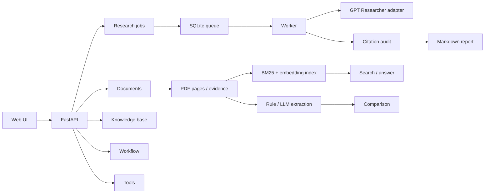

# SpectraScholar

> 一个本地优先的科研文献研究工作台：PDF 入库、页级证据、结构化抽取、多论文对比、混合检索与可核查引用。


SpectraScholar 把一次文献调研拆成可检查的步骤：**读 PDF → 定位页码 → 抽取字段 → 核验原文 → 比较实验条件 → 生成带引用的报告**。  
通用网页搜索与报告生成由 [GPT Researcher](https://github.com/assafelovic/gpt-researcher)（Apache-2.0）提供；本仓库实现科研业务层、证据约束、检索、队列和工作流。

---

## 1. 解决什么问题

通用研究报告工具能“搜到并写出来”，但科研阅读还多出三个问题：

1. **来源可追溯**：报告里的数值能否回到具体 PDF 的页码和原文片段？
2. **实验可比性**：两篇论文都写 OA=98%，它们的数据集、训练比例、patch size 和划分协议一致吗？
3. **拒绝编造**：找不到证据时，系统是否返回 `null` 或拒答，而不是补一个“合理”的数字？

SpectraScholar 的设计约束：

- 结构化字段必须绑定 `document_id + page + quote + verification status`；
- 只有实验条件一致的指标才进入同一可比组并排名；
- 引用核验区分原文通过、仅页码通过、失败引用和缺少引用的数值结论；
- RAG 在空检索或低重合时拒答；
- Demo 模式在任务、报告和页面中显式标注。

---

## 2. 功能

| 模块 | 能力 |
|---|---|
| 文献管理 | PDF 上传、SHA-256 去重、页级文本读取、删除与索引重建 |
| 结构化抽取 | 标题/作者/年份/会议、方法、数据集、图构建、OA/AA/Kappa、训练比例、patch size |
| 表格解析 | `pdfplumber` 表格抽取；可选 Tesseract OCR；无法确认时返回 `null` |
| 证据核验 | 页码存在、原文片段存在、字段值出现在 quote 中；失败候选拒绝 |
| 多论文对比 | 按数据集/指标/条件分组；不可比条件不排名；Markdown 导出 |
| 文献 RAG | BM25 + embedding + RRF + 词法重排；支持 hash、OpenAI-compatible、Ollama |
| 引用审计 | 页级引用、claim-level 映射、缺引用数值结论检测、外部链接标记 |
| 工作流 | 固定 DAG：plan → screen → retrieve → extract → verify → compare → report |
| 工具调用 | arXiv 搜索；有界 planner 在 arXiv / 本地检索间选择，最多 5 步 |
| 任务队列 | SQLite 持久队列 + worker；重试、stale lock 恢复、取消、时间/成本预算 |
| 界面 | 单页 Web UI：任务、报告、文献、检索、对比、工作流 |

---

## 3. 架构



更细的模块边界见 [docs/ARCHITECTURE.md](docs/ARCHITECTURE.md)。

---

## 4. 快速开始

### 4.1 安装

```bash
python -m venv .venv
# Windows
.venv\Scripts\activate
# macOS / Linux
source .venv/bin/activate

pip install -r requirements-dev.txt
cp .env.example .env
```

最低运行只需要 Python；OCR、LLM 和联网研究是可选依赖。

### 4.2 离线 Demo

```bash
# .env
RESEARCH_BACKEND=demo
QUEUE_BACKEND=inline

uvicorn spectrascholar.main:app --reload
```

打开 `http://127.0.0.1:8000/`。Demo 报告会明确标注“不是真实调研结果”。

### 4.3 接入真实研究后端

```dotenv
RESEARCH_BACKEND=gptr
OPENAI_API_KEY=...
# 或
DEEPSEEK_API_KEY=...
TAVILY_API_KEY=...
```

只配置 DeepSeek 时，项目会使用 DeepSeek 的 OpenAI-compatible 接口，并避免隐式调用 OpenAI embedding。  
如果同时配置 `OPENAI_API_KEY`，默认优先使用 OpenAI；可通过 `EXTRACTION_MODEL` / `ANSWER_MODEL` 覆盖。

### 4.4 使用本地 PDF

1. 上传 PDF 到 `POST /api/v1/documents`；
2. 把任务的 `source` 设为 `local`；
3. GPT Researcher 会读取 `workspace/papers/` 下的本地文献。

### 4.5 启动持久队列

```bash
# terminal 1
uvicorn spectrascholar.main:app --reload

# terminal 2
python scripts/run_worker.py

# 或只处理一个任务
python scripts/run_worker.py --once
```

`QUEUE_BACKEND=sqlite` 时任务会持久化；worker 崩溃后，超过 `QUEUE_LOCK_TIMEOUT_SECONDS` 的 running 任务可被重新领取。

### 4.6 本地 embedding

```dotenv
EMBEDDING_BACKEND=ollama
OLLAMA_BASE_URL=http://127.0.0.1:11434
OLLAMA_EMBEDDING_MODEL=bge-m3
```

macOS / Linux / Windows 安装 Ollama 后：

```bash
ollama pull bge-m3
ollama serve
```

如果使用独立的模型目录，可运行：

```powershell
powershell.exe -NoProfile -ExecutionPolicy Bypass -File .\scripts\start_ollama.ps1 `
  -OllamaExe "C:\path\to\ollama.exe" `
  -ModelsDir "D:\path\to\ollama_models"
```

`scripts/start_ollama.ps1` 只启动一个使用项目模型目录的独立进程，不修改系统 Ollama 服务。

### 4.7 Docker

```bash
docker compose build
docker compose up -d
docker compose ps
curl http://127.0.0.1:8000/api/v1/health
```

本仓库提供基础 Compose 配置；不同机器的 Docker 凭据、数据目录和代理需要按环境调整。

---

## 5. API

| 方法 | 路径 | 用途 |
|---|---|---|
| GET | `/api/v1/health` | 健康检查、运行模式 |
| GET | `/api/v1/config` | 安全配置（不含密钥） |
| POST | `/api/v1/research` | 提交研究任务 |
| GET | `/api/v1/research` | 任务列表 |
| GET | `/api/v1/research/{id}` | 任务详情与报告 |
| GET | `/api/v1/research/{id}/events` | 执行事件 |
| POST | `/api/v1/research/{id}/retry` | 重试失败任务 |
| POST | `/api/v1/research/{id}/cancel` | 取消任务 |
| POST | `/api/v1/documents` | 上传 PDF |
| GET | `/api/v1/documents` | 文献列表 |
| GET | `/api/v1/documents/{id}/pages/{n}` | 读取页文本 |
| DELETE | `/api/v1/documents/{id}` | 删除文献与索引 |
| POST | `/api/v1/compare` | 多论文对比 |
| POST | `/api/v1/kb/index` | 建立检索索引 |
| POST | `/api/v1/kb/search` | 检索；`mode=hybrid/vector/bm25` |
| POST | `/api/v1/kb/answer` | 带引用回答/拒答 |
| POST | `/api/v1/evidence/verify` | 页码/原文核验 |
| POST | `/api/v1/workflows` | 提交本地文献工作流 |
| GET | `/api/v1/tools/arxiv_search` | arXiv 工具 |
| POST | `/api/v1/tools/agent_loop` | 有界工具循环 |

---

## 6. 评测

### 检索：50 题、3 篇真实论文

| 模式 | Answer-level Recall@5 | 严格 page-level Recall@5 |
|---|---:|---:|
| BM25 | 68.0% | 62.0% |
| hash | 60.0% | 52.0% |
| bge-m3 vector | 78.0% | 72.0% |
| **bge-m3 hybrid** | **80.0%** | **72.0%** |
| router | 70.0% | 62.0% |

说明：

- 这是仓库内的 50 题自建集，gold 为 `document_id/page/quote`；
- 不是公开 benchmark，不能外推到所有论文；
- bge-m3 的最佳模式是 `hybrid`；`router` 是按另一组配置调过的规则，不推荐直接用于 bge-m3；
- 严格 page-level 仍有 28% 失败，详见 [docs/RETRIEVAL_FAILURE_ANALYSIS.md](docs/RETRIEVAL_FAILURE_ANALYSIS.md)。

### 结构化抽取：3 篇真实论文

| 字段 | 结果 |
|---|---:|
| title / year / venue / 主方法 | 3/3 |
| datasets | 9/9 |
| 指标数值 | 21/24 |
| 指标→数据集 | 21/24 |
| 实验条件 | 5/8 |
| 指标→训练比例/patch | 9/24 |
| 证据接受 | 271/277 |

OCR 仍可能误读，指标绑定不完整，因此不能直接做跨论文排名。

### 工程

```text
103 passed
coverage 85%
ruff: All checks passed
```

完整方法与限制见 [docs/EVALUATION.md](docs/EVALUATION.md)，检索评测见 [docs/EMBEDDING_EVAL.md](docs/EMBEDDING_EVAL.md)，结果数据见 [docs/retrieval_runs.md](docs/retrieval_runs.md)。

---

## 7. 项目结构

```text
spectrascholar/
├── main.py              # FastAPI app、中间件、异常
├── api/                 # HTTP 路由
├── research.py          # GPT Researcher adapter、任务执行
├── store.py             # SQLite schema 与持久化
├── job_queue.py         # 持久队列
├── evidence.py          # PDF 页文本与原文匹配
├── extraction/          # 规则/LLM 抽取、表格、OCR、证据拒绝
├── compare.py           # 多论文对比与可比组
├── citations.py         # 引用解析与 claim 审计
├── rag/                 # chunk、BM25、embedding、索引、检索
├── workflow.py          # 7 节点本地文献 DAG
├── agent/               # 有界工具循环
└── web/                 # 单页 UI

scripts/                 # 评测、worker、冒烟、Ollama 启动
tests/                   # 103 个离线测试
eval/                    # 标注、题集、示例
docs/                    # 架构、评测、工具与演示
```

---

## 8. 边界

当前版本：

- 单机 SQLite，不是多租户或分布式系统；
- 引用核验是“页码/原文/值”核验，不做语义蕴含；
- page-level 检索仍有失败，不能宣称语义检索已完全解决；
- OCR 表格仍有误读；
- Docker 配置需要在目标机器上验证；
- 外部网页链接不会自动联网核验。

这些限制在评测文档中保留，不用“已完成”替代“已验证”。

---

## 9. 许可证与上游

本项目代码采用 MIT License，见 [LICENSE](LICENSE)。

通用网页研究能力由 GPT Researcher 提供，遵循 Apache-2.0，见 [NOTICE](NOTICE)。  
本仓库不复制 GPT Researcher 源码；上游能力不应被表述为本仓库原创。

---

## 10. 文档

- [系统架构](docs/ARCHITECTURE.md)
- [评测方法与结果](docs/EVALUATION.md)
- [Embedding / 检索评测](docs/EMBEDDING_EVAL.md)
- [50 题失败分析](docs/RETRIEVAL_FAILURE_ANALYSIS.md)
- [Tool Calling](docs/TOOLS.md)
- [有界工具循环](docs/AGENT_LOOP.md)
- [演示流程](docs/DEMO.md)
- [评测题集说明](eval/README.md)
