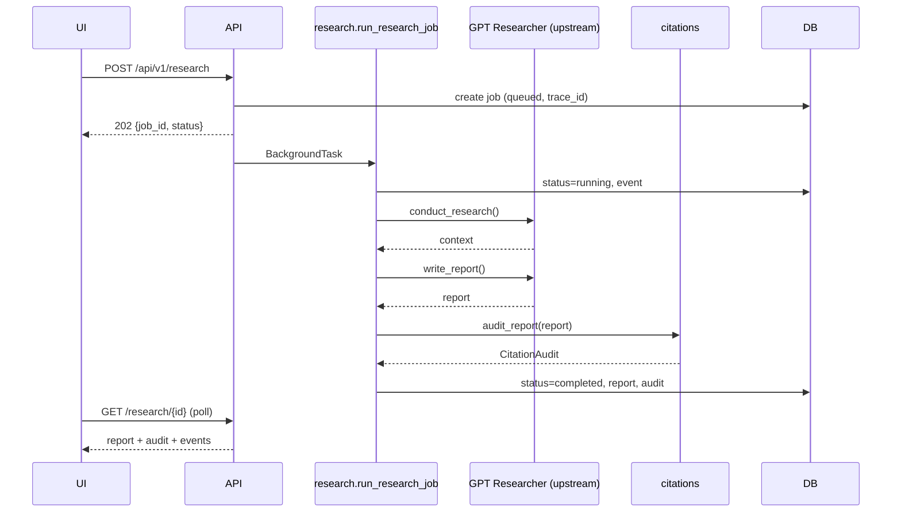
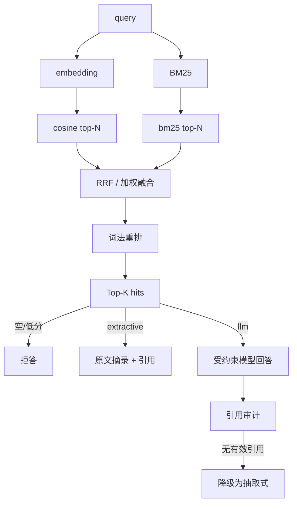

# SpectraScholar 系统架构

> 本文解释“为什么这样拆模块”，以及面试时如何讲清楚边界。实现细节以代码为准。

## 1. 目标与非目标

### 目标

1. 让一次科研调研的每个阶段**可观察**：任务、节点、状态、耗时、错误。
2. 让每个科学字段**可追溯**：文档、页码、原文片段、核验状态。
3. 让不同实验条件下的指标**不被错误排名**。
4. 保持单机可跑、依赖少、测试可离线执行。
5. 把通用研究能力（搜索/报告）与个人业务能力（证据/对比/RAG）清晰分层。

### 非目标（当前版本）

- 不做多租户 SaaS、Kubernetes、微服务拆分。
- 不复制 GPT Researcher 的搜索、抓取、报告生成内部实现。
- 不声称能自动复现论文代码或验证科学结论。
- 不做医疗/法律等高风险自动决策。

---

## 2. 模块职责

| 模块 | 职责 | 不负责 |
|---|---|---|
| `spectrascholar/main.py` | App 工厂、路由挂载、Trace、限流、安全头、异常格式 | 业务算法 |
| `api/*` | HTTP 参数校验、状态码映射、响应模型 | 长任务执行 |
| `research.py` | 后端选择、每任务配置、超时/重试、任务事件、引用审计 | 页面搜索/报告生成（上游） |
| `llm_config.py` | OpenAI/DeepSeek 聊天凭据解析；OpenAI 优先 | embedding 提供（DeepSeek 无） |
| `store.py` | SQLite schema/迁移、任务/文档/对比/工作流持久化 | 业务规则 |
| `evidence.py` | PDF 读取、页码/原文匹配原语 | 判断科学正确性 |
| `extraction/*` | 规则抽取、LLM 候选、表格结构解析、证据拒绝、字段缺失 | 复杂跨页表/多级表头/OCR |
| `compare.py` | 方法/数据集/指标对比、可比组、Markdown | 论文质量评价 |
| `citations.py` | 本地引用解析、外部链接标记、缺引用结论检测 | 联网核验、语义验证 |
| `rag/*` | chunk、BM25、embedding、混合检索、拒答、带引用回答 | 训练语义模型 |
| `workflow.py` | 本地 PDF 固定 DAG、节点状态、重试、报告 | 网页搜索 |
| `domains.py` | 领域 Prompt/数据集提示 | 业务逻辑 |
| `web/index.html` | 单页 UI、轮询、Markdown 展示、引用跳转 | 服务端逻辑 |

---

## 3. 关键请求流

### 3.1 真实网页研究（P0）



失败时：

- `TimeoutError` / 429 / 连接错误 → 可重试，最多 `RESEARCH_MAX_ATTEMPTS`；
- 缺 Key、缺依赖、空上下文、空报告 → 不可重试；
- 任何失败都写 `error_type` 和事件，不会留下 `running` 悬挂（进程崩溃除外）。

### 3.2 本地文献工作流（P3）


每个节点：

- 输入来自 `WorkflowState`；
- 输出摘要写入 `workflow_steps`；
- 超时 `WORKFLOW_STEP_TIMEOUT_SECONDS`；
- 失败后重试 `WORKFLOW_MAX_RETRIES` 次；
- 节点失败 → 整个工作流 `failed`，保留已完成节点；
- 不做断点恢复（重新提交；`idempotency_key` 防止重复）。

### 3.3 RAG 问答（P2）



---

## 4. 数据契约与验证层级

### 4.1 三层验证

```text
页码存在（page exists）
  └── 原文片段匹配（quote_on_page）
        └── 字段值在片段中逐字出现（value in quote）
              └── 语义/事实验证（semantic_checked = false，当前不自动做）
```

数据结构用 `EvidenceStatus` 区分：

| 状态 | 含义 |
|---|---|
| `verified_quote` | 页码 + 原文 + 值都匹配 |
| `verified_page_only` | 只确认页码 |
| `quote_found_value_mismatch` | 原文存在但值不在其中 |
| `quote_not_found` | 片段不在该页 |
| `page_missing` | 页码越界 |
| `document_missing` | 文档不存在 |
| `external_unchecked` | 外部 URL，未联网 |
| `malformed` | 引用语法错误 |
| `unverified` | 未检查 |

> 面试重点：**原文出现不等于事实正确，也不等于实验可比**。这是本项目的核心设计立场。

### 4.2 抽取字段

```text
PaperExtraction
├── metadata: PaperMetadata(title/authors/year/venue: ExtractedField)
├── methods: MethodRecord(name, family, graph_construction, evidence)
├── datasets: DatasetRecord(name, evidence)
├── graph_constructions: GraphConstructionRecord(kind, evidence)
├── experiment_conditions: ExperimentCondition(dataset, train_ratio, patch_size, protocol, evidence)
├── metrics: MetricRecord(dataset, method, metric, value, train_ratio, patch_size,
│                          protocol, source=text|table|llm, evidence)
├── missing_fields: list[str]
├── rejections: list[RejectionRecord]
└── stats: ExtractionStats
```

LLM 抽取的候选必须通过 `make_evidence_ref`，否则进入 `rejections`，不会进入结果字段。

### 4.3 表格抽取（P1-A 扩展）

`extraction/tables.py`：

1. pdfplumber 的 `find_tables()` 检测带线表格；
2. 表头别名映射到 OA/AA/Kappa；
3. 行首为方法名，列指标 → `MetricRecord(method=..., source="table")`；
4. 表格标题/上方区域提取数据集、训练比例、补丁、协议；
5. 数值必须在 pypdf 页文本中逐字出现，否则 `quote_not_found`；
6. `98.4/97.1` 等多值单元格 → `ambiguous_table_cell` 拒绝；
7. 与正文指标按 `(dataset, metric, value, page)` 去重；表格保留行列关联，正文补足条件；
8. 无表格/无 pdfplumber/PDF 打不开 → 自动降级，不阻断正文抽取。

> 表格结构证明“行/列关联”，页文本核验证明“数值确实出现在该页”，但**语义是否正确仍需人工确认**。

---

## 5. 可比性算法

`compare._metric_rows`：

1. 每条指标先计算缺失条件：
   - 无数据集；
   - 无训练比例；
   - 无补丁尺寸；
   - 无协议；
   - 无通过核验的证据。
2. 有任一缺失 → `comparable=false`，`comparable_group=null`，原因写入 `reason`；
3. 全部条件存在 → key：
   ```text
   dataset|metric|train_ratio|patch_size|protocol
   ```
4. 同一 key 至少来自 **2 篇不同文档**，才计算组内排名；
5. 排名按数值降序，记录 `rank_in_group`；仍然提示核对数据划分/随机种子/评估代码。

这解决了“98% vs 97% 谁更强”的常见误读：如果训练比例不同，根本不进入同一组。

---

## 6. 存储设计

SQLite 表：

| 表 | 主要字段 | 说明 |
|---|---|---|
| `jobs` | job_id, status, backend, is_demo, trace_id, attempts, report, citation_audit, elapsed_ms | 研究任务 |
| `job_events` | job_id, level, step, message, duration_ms | 执行日志 |
| `documents` | document_id, filename, stored_name, sha256, page_count, title | PDF 元数据 |
| `comparisons` | comparison_id, payload(JSON), markdown | 对比快照 |
| `workflows` | workflow_id, status, current_step, report, idempotency_key | 工作流 |
| `workflow_steps` | workflow_id, name, status, attempt, error, duration_ms | 节点状态 |

设计决策：

- 短连接 + `_ClosingConnection` 显式关闭，避免 Windows 文件锁；
- WAL 提升并发读；
- `init_store()` 做 `CREATE TABLE IF NOT EXISTS` + `ALTER TABLE ADD COLUMN` 轻量迁移；
- 报告同时写 DB 和 `workspace/reports/*.md`（本地演示方便；生产应对象存储）。

---

## 7. 并发、超时与失败

| 场景 | 策略 |
|---|---|
| 任务执行 | `QUEUE_BACKEND=sqlite`：`job_queue` + 独立 `scripts/run_worker.py`；`inline` 仅供测试 |
| 外部 API | 总超时 + 阶段超时；有限重试 + 退避 |
| 429 / 网络 | 可重试 |
| 缺 Key / 缺依赖 / 空输出 | 不可重试 |
| 工作流节点 | 单节点超时 + 重试；失败保留节点状态 |
| RAG | embedding 分批 + 2 次重试；空结果拒答 |
| PDF | 页数/字符上限；加密/损坏明确报错 |
| 进程崩溃 | 任务可能停留在 `running`；生产需队列心跳/超时回收（未实现） |

---

## 8. 安全设计

已实现：

- 可选 `X-API-Key`（单用户）；
- 写请求限流（内存滑动窗口）；
- 请求 Trace ID 与结构化错误；
- 安全响应头 / CSP；
- PDF 扩展名、文件头、大小、路径穿越、SHA-256 去重；
- `.env`、`workspace/*`、DB、索引、报告全部 Git 忽略；
- 日志不输出 Key；错误信息做掩码；
- 外部链接默认不访问，标记 `external_unchecked`。

公网前必须补：

- 多租户隔离；对象存储权限；HTTPS；反向代理；
- 恶意 PDF 扫描、病毒扫描、内容安全；
- 任务队列、预算、取消；
- 备份与审计日志保留策略。

---

## 9. 为什么没有直接上 LangGraph / 向量数据库？

**LangGraph**：当前工作流是固定 7 节点 DAG，节点契约、状态和测试已经明确。用自建状态机可以先验证业务，不引入额外框架复杂度。迁移路径：

- 保留 `WorkflowState` / 节点函数签名；
- 用 `StateGraph` 包装同一组函数；
- 继续用 `workflow_steps` 持久化；
- 是否需要动态路由（例如根据证据质量回到检索节点）由真实失败案例决定。

**向量库**：个人 PDF 规模小，内存 + JSON 足够；接口 `KnowledgeIndex.add_document/search/remove_document` 已抽象。替换为 pgvector/Qdrant 时只需换实现，不改 API。

---

## 10. 扩展点

| 想做什么 | 改哪里 |
|---|---|
| 增加新数据集 | `extraction/heuristic.py::DATASET_PATTERNS` |
| 增加新模型家族 | `MODEL_PATTERNS` + `infer_family` |
| 换领域 Prompt | `domains.py` |
| 换聊天 provider | 改 `llm_config.py` + `research.py` 的 provider 密钥映射 |
| 换真实向量库 | `rag/index.py` 实现同名接口 |
| 换 reranker | `rag/index.py` 的 `rerank` 分支 |
| 扩展复杂表格 | 改 `extraction/tables.py`，输出同样 `MetricRecord(source="table")` |
| 加 OCR | 在 `read_pdf_pages`/表格解析前加 OCR fallback，保持页码映射 |
| 加 OCR | `evidence.read_pdf_pages` 前置 fallback |
| 换任务队列 | `api/research.py` 的 `tasks.add_task` → RQ/Celery |
| 加多用户 | `documents/jobs` 增加 owner 字段 + 查询过滤 + 鉴权 |
| 换 PostgreSQL | `store.py` 抽象 repository，SQL 迁移 |

---

## 11. 已知限制

1. 真实 GPT Researcher **本地 PDF** 模式已用 DeepSeek 完成 10/10 任务；真实**网页检索**完成 10/10（Tavily，当前代理环境需临时 `ALLOW_PRIVATE_URLS=true`）。
2. 3 篇真实论文已完成抽取评测（LLM 元数据/方法/数据集强，文本表 + Tesseract OCR 绑定 17/24；OCR 仍有误读）；真实论文检索评测仍未完成。
3. hash embedding 非语义；语义检索质量未验证。
4. 表格解析只覆盖带线结构表；复杂跨页表、多级表头、合并单元格、图片表格仍需人工或 OCR。
5. 检索消融在 hash 词法嵌入下三模式并列，尚未证明语义/混合检索收益。
6. 外部链接不联网核验。
7. SQLite worker 解决单机可靠队列；跨机器并发仍需 Redis/RQ。
8. 无 OCR、无病毒扫描、无多租户。
9. Docker 构建未验证（无 Docker CLI）。
10. 页面截图未生成（浏览器 IPC 被沙箱阻断）。
11. DeepSeek 只用于聊天/抽取/问答；没有 embedding API，语义检索仍需其他 provider。
